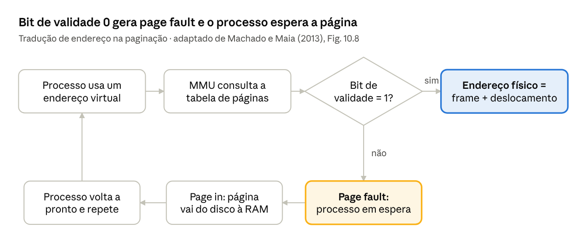

# Gerência de Memória Virtual: dos fundamentos às tecnologias atuais

8 de novembro de 2026

**Autores:** Alexandre Reitemeyer, Angelo Pandolfo Antonini, Beatriz Aparecida Miranda, Eduardo de Oliveira da Silva, Felipe Samuel Janissk, Gabriel Nassinger, Gustavo Henrique de Marchi Meurer, Jessé Chaves e Lucas Santos Magro

**Disciplina:** 11781 – Sistemas Operacionais · Universidade do Oeste de Santa Catarina (Unoesc)

## Resumo

A memória virtual continua sendo a base da gerência de memória dos sistemas atuais: os mecanismos descritos por Machado e Maia (2013) aparecem quase sem mudança no Windows, no Linux e nos processadores x86-64 e ARM. Este artigo explica os conceitos do Capítulo 10 do livro — espaço de endereçamento virtual, paginação, políticas e algoritmos de substituição, *working set*, TLB, segmentação, *swapping* e *thrashing*. Em seguida, compara cada conceito com a forma como é implementado hoje, usando documentação técnica oficial apenas para validar o livro.

O que mudou foi a escala e o refinamento: tabelas de páginas com quatro ou cinco níveis, TLB que identifica o processo e evita ser esvaziada na troca de contexto, páginas grandes, compressão de memória antes do disco e um bit de proteção contra execução. O princípio da localidade segue sendo o que faz todo o mecanismo funcionar.

**Palavras-chave:** memória virtual; paginação; substituição de páginas; TLB; *thrashing*.

## 1 Introdução

A memória virtual resolve um limite das técnicas de gerência de memória real: o programa não precisa mais caber inteiro na memória principal. Nas técnicas anteriores, como partições e *overlay*, o tamanho do programa ficava preso ao tamanho da RAM, e a fragmentação desperdiçava espaço (MACHADO; MAIA, 2013, seção 10.1).

Segundo os autores, a memória virtual é "uma técnica sofisticada e poderosa de gerência de memória, em que as memórias principal e secundária são combinadas dando ao usuário a ilusão de existir uma memória muito maior que a capacidade real da memória principal" (MACHADO; MAIA, 2013, seção 10.1). Além de permitir programas maiores que a RAM, a técnica deixa mais processos na memória ao mesmo tempo, aproveita melhor o processador e reduz a fragmentação.

A ideia é antiga. A primeira implementação foi o sistema Atlas, da Universidade de Manchester, no início dos anos 1960, e a IBM a levou ao mercado na família System/370, em 1972. Hoje praticamente todo sistema operacional de uso geral a implementa.

**Objetivo.** Explicar os conceitos do Capítulo 10 do livro e mostrar, para cada um, como ele aparece nos sistemas e processadores atuais.

**Método.** O livro é a fonte principal, como pede a disciplina. A documentação oficial da Microsoft, do kernel Linux, da Apple e do Android foi usada apenas para validar e atualizar os conceitos do livro, sem acrescentar temas fora do escopo da gerência de memória virtual.

As seções 2 a 8 seguem a ordem do capítulo. A seção 9 faz o comparativo com as tecnologias atuais, e a seção 10 traz as considerações finais.

## 2 Fundamentos: espaço de endereçamento e mapeamento

Na memória virtual, o programa usa apenas endereços virtuais, e cada um é traduzido para um endereço físico no momento da execução. Essa tradução se chama **mapeamento** (MACHADO; MAIA, 2013, seções 10.2 e 10.3).

### 2.1 Espaço virtual e espaço real

O livro compara a memória virtual a um vetor. Quem escreve `vetor[42]` não sabe nem precisa saber em que posição física o dado está: o compilador cuida disso. A memória virtual aplica a mesma abstração ao programa inteiro.

- **Espaço de endereçamento virtual:** o conjunto de endereços que o processo pode usar.
- **Espaço de endereçamento real:** o conjunto de endereços que o processador pode acessar na memória principal.

Os dois espaços não têm relação direta, então o programa pode usar endereços que não cabem na RAM. Durante a execução, só uma parte do código fica na memória principal. O resto fica na memória secundária até ser referenciado.

### 2.2 Mapeamento e MMU

A tradução é feita pelo hardware junto com o sistema operacional, para não prejudicar o desempenho. O componente responsável é a **unidade de gerência de memória** (*Memory Management Unit*, MMU), acionada a cada referência a um endereço virtual.

Cada processo tem sua própria **tabela de mapeamento**. Na troca de contexto, um registrador passa a apontar para a tabela do novo processo. Como consequência do mapeamento, o programa não precisa ocupar posições contíguas na RAM.

### 2.3 Por que mapear em blocos

Se cada endereço tivesse sua própria entrada, a tabela seria do tamanho do espaço virtual, o que inviabilizaria a técnica. Por isso as tabelas mapeiam blocos: quanto maior o bloco, menos entradas e menor a tabela.

| Espaço virtual | Tamanho do bloco | Número de blocos (entradas na tabela) |
| --- | --- | --- |
| 2³² endereços | 512 endereços | 2²³ |
| 2³² endereços | 4 K endereços | 2²⁰ |
| 2⁶⁴ endereços | 4 K endereços | 2⁵² |
| 2⁶⁴ endereços | 64 K endereços | 2⁴⁸ |

*Fonte: Machado e Maia (2013), Tabela 10.1.*

O tamanho do bloco define três técnicas: blocos de tamanho fixo (**paginação**), blocos de tamanho variável (**segmentação**) e a combinação das duas (**segmentação com paginação**).

## 3 Memória virtual por paginação

A paginação divide os espaços virtual e real em blocos do mesmo tamanho: **páginas virtuais** e **páginas reais**, também chamadas de *frames*. É a técnica mais importante do capítulo, e muitos dos seus conceitos valem também para a segmentação (MACHADO; MAIA, 2013, seção 10.4).

### 3.1 Tabela de páginas e tradução do endereço

Cada processo tem uma **tabela de páginas**, com uma entrada (ETP) por página virtual. A ETP guarda o endereço do *frame* e bits de controle, como o **bit de validade**: 1 indica que a página está na RAM, 0 indica que não está.

O endereço virtual tem duas partes. O **número da página virtual (NPV)** funciona como índice na tabela, e o **deslocamento** indica a posição dentro da página. O endereço físico combina o endereço do *frame* com o deslocamento:

```latex
\text{endereço físico} = \text{número do frame} \times \text{tamanho da página} + \text{deslocamento}
```

**Exemplo.** Com páginas de 4 KB (4.096 endereços), o endereço virtual 8.200 fica na página 2 com deslocamento 8, pois 8.200 = 2 × 4.096 + 8. Se a tabela indica que a página 2 está no *frame* 5, o endereço físico é 5 × 4.096 + 8 = 20.488. Com endereços de 32 bits, são 20 bits de NPV e 12 de deslocamento, porque 2¹² = 4.096.

### 3.2 *Page fault*

Quando o bit de validade é 0, a página não está na memória e ocorre um ***page fault***. O sistema então lê a página do disco para a RAM, uma operação de E/S chamada ***page in***.

Enquanto espera a página, o processo sai do estado de execução e vai para o estado de espera. Quando a leitura termina, ele volta para a fila de prontos. O número de *page faults* num intervalo de tempo é a **taxa de paginação** do processo: algum *page fault* é normal, mas uma taxa alta gera excesso de E/S e derruba o desempenho.



*Figura 1 – Tradução de endereço e tratamento do page fault. Fonte: adaptado de Machado e Maia (2013), Fig. 10.8.*

Com o bit de validade igual a 1, a tradução é imediata. Com o bit igual a 0, o processo espera o *page in* e repete o acesso quando volta a executar.

### 3.3 Políticas de busca e de alocação

A **política de busca** decide *quando* uma página vai para a memória. A **política de alocação** decide *quantos frames* cada processo pode ter.

| Política | Como funciona | Vantagem | Desvantagem |
| --- | --- | --- | --- |
| Busca por demanda | Carrega a página só quando é referenciada | Só o necessário vai para a RAM; rotinas de erro podem nunca ser carregadas | Muitos *page faults* no início da execução |
| Busca antecipada (*prepaging*) | Carrega também páginas vizinhas à referenciada | Ler páginas em sequência no disco é mais rápido que ler uma por vez | Gasta tempo e memória se as páginas extras não forem usadas |
| Alocação fixa | Limite de *frames* definido na criação do processo | Simples | Limite pequeno gera muitos *page faults*; limite grande deixa menos processos na RAM |
| Alocação variável | Limite muda conforme a taxa de paginação e a ocupação da RAM | Adapta-se ao comportamento do processo | O SO precisa monitorar os processos (mais *overhead*) |

*Fonte: elaborado a partir de Machado e Maia (2013), seções 10.4.1 e 10.4.2.*

### 3.4 Políticas de substituição

Quando o processo atinge seu limite de *frames*, o sistema precisa escolher uma página para liberar. Se ela foi modificada, é gravada antes no **arquivo de paginação** (*page file*), operação chamada ***page out***. O sistema sabe quais páginas mudaram pelo **bit de modificação** (*dirty bit*). Páginas de código não precisam de *page out*, porque o executável em disco já tem uma cópia.

O **escopo** da substituição pode ser:

- **Local:** só as páginas do processo que gerou o *page fault* são candidatas.
- **Global:** qualquer página da memória é candidata, menos as do núcleo, que ficam bloqueadas.

A alocação fixa só permite substituição local, porque o processo precisa manter seu limite. A alocação variável permite as duas: na global, o processo que gerou o *page fault* ganha um *frame* e outro processo perde um.

## 4 Localidade, *working set* e algoritmos de substituição

A memória virtual só é eficiente porque os programas concentram seus acessos em poucas páginas por vez. Esse é o **princípio da localidade**, base do modelo de *working set* e de quase todos os algoritmos de substituição (MACHADO; MAIA, 2013, seções 10.4.4 e 10.4.5).

### 4.1 Princípio da localidade

- **Localidade espacial:** depois de acessar um endereço, o programa tende a acessar endereços próximos.
- **Localidade temporal:** um endereço acessado tende a ser acessado de novo em pouco tempo.

Um laço cujo código ocupa três páginas, por exemplo, usa essas três páginas repetidamente. Basta mantê-las na RAM para o laço rodar sem *page faults*. Sem localidade, o sistema teria que manter o programa inteiro na memória para evitar o *thrashing*.

### 4.2 *Working set*

Peter Denning (1968) definiu o *working set* como o conjunto de páginas referenciadas por um processo numa janela de tempo Δt. No exemplo do livro, o *working set* no instante t2 são as páginas P2, P3 e P8.

Se o *working set* de cada processo estiver na RAM, a taxa de paginação cai e o *thrashing* é evitado. O livro mostra que, a partir de certo ponto, dar mais *frames* ao processo quase não reduz os *page faults*. Esse ponto chega muito antes de o programa inteiro estar na memória.

O modelo só funciona com alocação variável, porque o *working set* muda ao longo da execução. Uma forma de implementá-lo é a **estratégia de frequência de *page fault***, usada de forma semelhante no OpenVMS: o processo com taxa acima de um limite ganha *frames*, e o processo com taxa abaixo perde.

### 4.3 Algoritmos de substituição

O objetivo é retirar a página com menor chance de ser usada em breve. Quanto mais sofisticado o algoritmo, maior o custo para o sistema.

| Algoritmo | Escolhe para sair | Ponto forte | Limitação |
| --- | --- | --- | --- |
| Ótimo | A página que não será mais usada ou que levará mais tempo para ser usada | Menor taxa de paginação possível | Impossível de implementar: o SO não conhece o futuro; serve só de referência |
| Aleatório | Qualquer página | Custo mínimo | Baixa eficiência; raramente usado |
| FIFO | A página há mais tempo na memória | Simples (uma fila) | Pode retirar páginas antigas muito usadas |
| LFU | A página menos referenciada | Preserva as páginas muito usadas | Penaliza páginas recém-carregadas e mantém páginas que só foram muito usadas no passado |
| LRU | A página há mais tempo sem ser referenciada | Eficiência próxima do ótimo | Custo alto: registrar o momento de cada acesso |
| NRU | Uma página com bit de referência 0 | Aproxima o LRU com um único bit | Distingue apenas "usada recentemente" ou não |
| FIFO com *buffer* de páginas | A primeira da lista de páginas alocadas, que vai para uma lista de livres | A página pode voltar ao processo sem acesso ao disco | Precisa manter duas listas |
| FIFO circular (*clock*) | A mais antiga com bit de referência 0; se o bit for 1, zera e avança | "Segunda chance" para páginas usadas; usado na maioria dos Unix | Pode percorrer a lista inteira antes de escolher |

*Fonte: elaborado a partir de Machado e Maia (2013), seção 10.4.5.*

No NRU, usar também o bit de modificação (BM) melhora a escolha. A ordem de preferência é: BR = 0 e BM = 0 (não usada e não modificada, sem *page out*), depois BR = 0 e BM = 1, depois BR = 1 e BM = 0 e por último BR = 1 e BM = 1. O livro registra que o Mach usa um *buffer* único, enquanto o OpenVMS e o MS Windows usam dois: uma lista de páginas livres e outra de páginas modificadas.

### 4.4 Exemplo comparativo

O Exercício 23b do livro usa a sequência de referências **1 2 3 1 4 1 3 2 3 3** com 3 *frames*. "F" marca um *page fault*, com a página retirada entre parênteses.

| Referência | 1 | 2 | 3 | 1 | 4 | 1 | 3 | 2 | 3 | 3 | Total |
| --- | --- | --- | --- | --- | --- | --- | --- | --- | --- | --- | --- |
| FIFO | F | F | F | – | F (sai 1) | F (sai 2) | – | F (sai 3) | F (sai 4) | – | **7** |
| LRU | F | F | F | – | F (sai 2) | – | – | F (sai 4) | – | – | **5** |
| Ótimo | F | F | F | – | F (sai 2) | – | – | F (sai 1) | – | – | **5** |

*Fonte: elaborado pelos autores a partir do Exercício 23b de Machado e Maia (2013); resultados conferidos por simulação.*

O LRU empata com o ótimo porque o programa volta sempre às páginas 1 e 3. O FIFO retira a página 1 só por ser a mais antiga e logo precisa dela de novo. Na sequência do Exercício 23a (1 2 3 1 4 2 5 3 4 3), porém, o FIFO causa 5 *page faults* e o LRU causa 8. Nenhum algoritmo é o melhor em todos os casos: o resultado depende da localidade do programa.

## 5 Suporte de hardware: tamanho de página, múltiplos níveis e TLB

Três decisões de hardware definem o custo da paginação: o tamanho da página, a organização da tabela de páginas e a cache de traduções, chamada TLB (MACHADO; MAIA, 2013, seções 10.4.6 a 10.4.8).

### 5.1 Tamanho de página

O tamanho da página depende do processador e, segundo o livro, costuma ficar entre 512 e 16 M endereços. A escolha envolve uma troca:

|  | Páginas pequenas | Páginas grandes |
| --- | --- | --- |
| Tamanho da tabela de páginas | Maior | Menor |
| Fragmentação interna | Menor | Maior (sobra espaço na última página) |
| Uso da RAM | Só as partes mais usadas ficam na memória | Traz junto código pouco usado |
| *Page faults* e E/S | Mais *page faults*; ler duas páginas de 512 bytes custa bem mais que uma de 1.024 | Menos operações de E/S |

*Fonte: elaborado a partir de Machado e Maia (2013), seção 10.4.6.*

O livro conclui que, com o aumento do espaço de endereçamento e da velocidade da memória, a tendência é adotar páginas maiores. A seção 9 mostra que essa tendência se confirmou.

### 5.2 Paginação em múltiplos níveis

Com endereços de 32 bits e páginas de 4 K, uma tabela de um nível tem 2²⁰ entradas, mais de um milhão. Com 4 bytes por entrada, são 4 MB de tabela **por processo**.

A solução é aplicar a localidade às próprias tabelas. Na paginação em dois níveis, o NPV se divide em NPV1 (10 bits), que localiza uma tabela de páginas dentro de uma **tabela-diretório**, e NPV2 (10 bits), que localiza o *frame* dentro dessa tabela. Os 12 bits restantes são o deslocamento. Só as tabelas realmente usadas ficam na RAM.

Em 64 bits, dois níveis não bastam, e o livro cita três níveis em processadores SPARC e quatro no Motorola 68030. O custo é que **cada nível acrescenta pelo menos um acesso à memória** em cada tradução.

### 5.3 *Translation Lookaside Buffer* (TLB)

Sem ajuda, cada acesso a um dado exigiria ao menos dois acessos à memória: um à tabela de páginas e outro ao dado. A **TLB** é uma memória cache que guarda as traduções das páginas usadas mais recentemente e consulta todas as entradas ao mesmo tempo (mapeamento associativo).

- **TLB *hit*:** a tradução está na TLB e a tabela de páginas nem é consultada.
- **TLB *miss*:** consulta-se a tabela. Se a página estiver na RAM, a tradução é copiada para a TLB; se não estiver, ocorre um *page fault*.

Cada entrada da TLB guarda a *tag* (endereço virtual sem o deslocamento), os bits de modificação e de referência, a proteção e o endereço físico. Graças à localidade, poucas entradas bastam: o livro fala em 8 a 2.048, com taxa de acerto muito alta.

O livro aponta uma limitação importante: em geral a TLB guarda só traduções do processo em execução e precisa ser reinicializada a cada troca de contexto. A alternativa é um campo extra que identifique o processo, solução adotada pelos processadores atuais (seção 9.2).

## 6 Proteção e compartilhamento de memória

A mesma tabela de páginas que traduz endereços também isola os processos e permite que eles compartilhem memória de forma controlada (MACHADO; MAIA, 2013, seções 10.4.9 e 10.4.10).

**Proteção.** O primeiro nível de proteção vem do próprio mecanismo: cada processo só enxerga a sua tabela, então não consegue acessar a memória de outro, a menos que haja compartilhamento explícito. Além disso, bits na entrada da tabela definem os acessos permitidos a cada página. O livro trabalha com dois tipos de acesso, leitura e gravação, que combinados vão de "sem acesso" até "leitura e gravação". Uma tentativa de gravar numa página só de leitura gera um erro.

**Compartilhamento.** Para compartilhar código, basta que as tabelas de processos diferentes apontem para os mesmos *frames*. Assim, um programa reentrante usado por vários processos tem uma única cópia na RAM, enquanto cada processo mantém sua própria área de dados. O mesmo mecanismo permite compartilhar dados para leitura e gravação, e nesse caso a aplicação é responsável por sincronizar os acessos.

## 7 Segmentação e segmentação com paginação

Na segmentação, o espaço virtual é dividido em blocos de tamanhos diferentes, os **segmentos**, que seguem a estrutura lógica do programa: um procedimento, uma função, um vetor ou a pilha (MACHADO; MAIA, 2013, seção 10.5). Normalmente é o compilador que define os segmentos.

O mapeamento funciona como na paginação. O endereço tem o **número do segmento virtual (NSV)** e um deslocamento, e o NSV indexa a **tabela de mapeamento de segmentos**. Cada entrada guarda o endereço do segmento, seu tamanho, os bits de validade, modificação e referência e a proteção.

A grande vantagem é lidar com estruturas de dados dinâmicas, como pilhas e listas: basta alterar o tamanho do segmento na tabela. A desvantagem é a **fragmentação externa**. Os segmentos são alocados com *best-fit*, *worst-fit* ou *first-fit*, e podem sobrar áreas livres pequenas demais para qualquer segmento novo.

| Característica | Paginação | Segmentação |
| --- | --- | --- |
| Tamanho dos blocos de memória | Iguais | Diferentes |
| Proteção | Complexa | Mais simples |
| Compartilhamento | Complexo | Mais simples |
| Estruturas de dados dinâmicas | Complexo | Mais simples |
| Fragmentação interna | Pode existir | Não existe |
| Fragmentação externa | Não existe | Pode existir |
| Programação modular | Dispensável | Indispensável |
| Alteração do programa | Mais trabalhosa | Mais simples |

*Fonte: Machado e Maia (2013), Tabela 10.5.*

**Segmentação com paginação.** Esta técnica divide o espaço em segmentos e cada segmento em páginas, buscando as vantagens das duas (MACHADO; MAIA, 2013, seção 10.6). O endereço tem três partes: NSV, NPV e deslocamento. O NSV aponta para a tabela de páginas do segmento, o NPV aponta para o *frame*, e o deslocamento completa o endereço. O programador continua vendo segmentos, mas o sistema enxerga páginas, então o segmento não precisa ser contíguo e a fragmentação externa desaparece.

## 8 *Swapping* e *thrashing*

Quando falta memória, o sistema pode tirar processos inteiros da RAM. Se a falta for grave, ele passa mais tempo movendo páginas do que executando programas (MACHADO; MAIA, 2013, seções 10.7 e 10.8).

### 8.1 *Swapping* em memória virtual

Se não há memória livre para novos processos, o sistema escolhe processos para sair. No ***swap out***, as páginas ou segmentos do processo são gravados num **arquivo de *swap*** e os *frames* são liberados. Depois, no ***swap in***, o processo volta para a RAM para continuar a execução.

O sistema tenta escolher processos com pouca chance de executar em breve. Primeiro vêm os processos em estado de espera e, se não bastar, os prontos de menor prioridade. O arquivo de *swap* é compartilhado por todos os processos e, em alguns sistemas, é o mesmo arquivo de paginação ou uma área reservada do disco.

A diferença em relação à seção 3.4: o *page out* retira **uma página**, e o *swap out* retira **o processo inteiro**.

### 8.2 *Thrashing*

*Thrashing* é a transferência excessiva de páginas ou segmentos entre a memória principal e a secundária. Na paginação, ele ocorre em dois níveis:

- **No processo:** o limite de *frames* é menor que o *working set*, ou o programa não tem localidade. O processo passa mais tempo esperando páginas do que executando.
- **No sistema:** há mais processos competindo pela memória do que espaço disponível. Reduzir os *frames* de cada processo leva ao *thrashing* do processo; recorrer ao *swapping* em excesso faz o sistema passar mais tempo trocando processos do que atendendo-os.

Na segmentação, o *thrashing* do processo vem da modularização extrema do programa. O livro conclui que, se houver mais processos do que memória real, a única solução é **aumentar a memória principal**.

## 9 Comparativo com as tecnologias atuais

Os mecanismos descritos por Machado e Maia continuam em uso, e o que mudou foi a escala e o refinamento. Os sistemas atuais têm mais níveis de tabela, uma TLB que identifica o processo, páginas maiores, compressão de memória antes do disco, proteção contra execução e um segundo nível de tradução para máquinas virtuais. Cada item abaixo parte de um conceito do livro e mostra como ele aparece hoje, segundo a documentação oficial.

### 9.1 Tabelas de páginas com mais níveis

O livro já indicava que, em 64 bits, dois níveis não bastam. Hoje, quatro níveis são o padrão, e o x86-64 já admite cinco.

| Sistema | Níveis de tabela | Endereço virtual | Espaço virtual |
| --- | --- | --- | --- |
| Exemplo do livro (32 bits, páginas de 4 K) | 2 | 32 bits | 4 G endereços |
| [x86-64 com paginação de 4 níveis](https://docs.kernel.org/arch/x86/x86_64/5level-paging.html) | 4 | 48 bits | 256 TiB |
| [x86-64 com paginação de 5 níveis](https://docs.kernel.org/arch/x86/x86_64/5level-paging.html) | 5 | 57 bits | 128 PiB |
| [ARM64 no Linux, páginas de 4 KB](https://docs.kernel.org/arch/arm64/memory.html) | 3 ou 4 | 39 ou 48 bits | 512 GB ou 256 TB |
| [ARM64 no Linux, páginas de 64 KB](https://docs.kernel.org/arch/arm64/memory.html) | 2 | 42 bits | 4 TB |

*Fontes: Machado e Maia (2013), seção 10.4.7; The Linux Kernel (\[s.d.\]a; \[s.d.\]b). O número de bits do x86-64 foi calculado pelos autores: 256 TiB = 2⁴⁸ e 128 PiB = 2⁵⁷.*

O caso do ARM confirma a troca descrita no livro: com páginas de 64 KB o deslocamento é maior, sobram menos bits para o NPV e bastam dois níveis de tabela.

### 9.2 TLB que identifica o processo

O livro diz que a TLB, em geral, precisa ser reinicializada a cada troca de contexto, a menos que cada entrada tenha um campo de identificação do processo. Os processadores x86 atuais têm esse campo: o **PCID** (*Process Context Identifier*). Segundo a [documentação do kernel Linux](https://docs.kernel.org/arch/x86/pti.html), o PCID é o recurso que permite não esvaziar a TLB inteira; sem ele, cada escrita no registrador CR3 esvazia a TLB toda (THE LINUX KERNEL, \[s.d.\]c).

O CR3 é justamente o registrador que aponta para a tabela do processo, descrito na seção 2.2. O PCID ganhou mais importância com a PTI (*Page Table Isolation*), contramedida ao ataque Meltdown que separa as tabelas do núcleo e do usuário: o PCID torna essas trocas de tabela mais baratas.

### 9.3 Páginas grandes: a tendência que o livro apontou

O livro concluiu que a tendência era adotar páginas maiores, e os sistemas atuais confirmam isso.

- **Linux:** o [*Transparent Hugepage Support*](https://docs.kernel.org/admin-guide/mm/transhuge.html) usa páginas de 2 MB. Cada entrada da TLB mapeia mais memória, o que reduz os TLB *misses*, e ocorre um único *page fault* para cada região de 2 MB acessada (THE LINUX KERNEL, \[s.d.\]d).
- **Windows:** as alocações em páginas grandes não são pagináveis e por isso não entram no *working set* nem geram *page faults* ([MICROSOFT, 2025a](https://learn.microsoft.com/en-us/windows/win32/memory/working-set)).
- **Apple:** o [iOS em processadores A9](https://developer.apple.com/library/archive/documentation/Performance/Conceptual/ManagingMemory/Articles/AboutMemory.html) usa páginas de 16 KB, contra 4 KB no OS X e nas versões antigas do iOS (APPLE, \[s.d.\]).

O custo apontado pelo livro continua valendo: páginas maiores aumentam a fragmentação interna.

### 9.4 *Working set*, *buffer* de páginas e substituição

**O Windows usa o próprio termo *working set*.** A [Microsoft](https://learn.microsoft.com/en-us/windows/win32/memory/working-set) o define como o conjunto de páginas do espaço virtual do processo que estão na memória física. Cada processo tem um tamanho mínimo e um máximo de *working set*, e o gerenciador de memória retira páginas dos *working sets* para liberar memória (MICROSOFT, 2025a). É a alocação variável do livro, com limites.

**O FIFO com *buffer* de páginas continua em uso.** O Windows diferencia dois tipos de *page fault*:

- ***Hard page fault*:** exige ler a página do arquivo de paginação ou de um arquivo mapeado. É o *page fault* do livro.
- ***Soft page fault*:** resolvido sem acessar o disco. Acontece, por exemplo, quando a página já foi retirada dos *working sets* mas ainda não foi reaproveitada (página "em transição").

A página em transição é exatamente a página que entrou na lista de livres do livro e pode voltar ao processo sem acesso ao disco. Se ela foi modificada, precisa ser gravada antes de ser reaproveitada, o que corresponde ao *page out* e à lista de páginas modificadas (MICROSOFT, 2025a). A [Apple](https://developer.apple.com/library/archive/documentation/Performance/Conceptual/ManagingMemory/Articles/AboutMemory.html) organiza a memória de forma parecida, com listas de páginas ativas, inativas e livres e a mesma distinção entre *soft* e *hard faults* (APPLE, \[s.d.\]).

**O LRU segue sendo aproximado.** O livro explica que o LRU puro é caro demais. O Linux oferece o [*Multi-Gen LRU*](https://docs.kernel.org/admin-guide/mm/multigen_lru.html), uma implementação alternativa do LRU que melhora o desempenho sob pressão de memória e ajuda computadores pessoais a evitar o *thrashing* (THE LINUX KERNEL, \[s.d.\]f).

**A busca antecipada também continua.** O parâmetro [`page-cluster`](https://docs.kernel.org/admin-guide/sysctl/vm.html) do Linux define quantas páginas consecutivas são lidas do *swap* de uma vez. O padrão é 3, ou seja, 2³ = 8 páginas (THE LINUX KERNEL, \[s.d.\]e). É a mesma lógica do livro: ler páginas em sequência no disco custa menos que lê-las uma por vez.

### 9.5 *Swapping*: compressão antes do disco

No livro, a página ou o processo retirado vai direto para o disco. Os sistemas atuais acrescentaram uma camada intermediária: **memória comprimida na própria RAM**.

- **Windows 10:** em 2015 a Microsoft anunciou o *compression store*, uma coleção de páginas comprimidas na memória. Quando há pressão de memória, o gerenciador [comprime páginas não usadas em vez de gravá-las no disco](https://blogs.windows.com/windows-insider/2015/08/18/announcing-windows-10-insider-preview-build-10525/), o que mantém mais aplicações na memória física (AUL, 2015).
- **Linux:** o [zswap](https://docs.kernel.org/admin-guide/mm/zswap.html) é um cache comprimido para páginas de *swap* que troca ciclos de CPU por menos E/S de *swap* (THE LINUX KERNEL, \[s.d.\]g). O [zram](https://docs.kernel.org/admin-guide/blockdev/zram.html) cria dispositivos na RAM com compressão, que podem ser usados como disco de *swap* (THE LINUX KERNEL, \[s.d.\]h).

O arquivo de paginação continua existindo. No Windows, o [arquivo de paginação](https://learn.microsoft.com/en-us/troubleshoot/windows-client/performance/introduction-to-the-page-file) é opcional e serve para retirar da RAM as páginas modificadas pouco acessadas. O limite de memória comprometida é a soma da RAM com os arquivos de paginação. Quando o sistema gerencia o tamanho, o arquivo pode crescer até três vezes a RAM ou 4 GB, o que for maior, limitado a um oitavo do volume (MICROSOFT, 2026).

Nos celulares, o *swap out* de processos inteiros dá lugar ao encerramento de processos:

- **iOS:** [não há arquivo de *swap*](https://developer.apple.com/library/archive/documentation/Performance/Conceptual/ManagingMemory/Articles/AboutMemory.html). Dados graváveis nunca são retirados da memória pelo sistema, e só páginas somente leitura são relidas do disco (APPLE, \[s.d.\]).
- **Android:** o [*low memory killer daemon*](https://source.android.com/docs/core/perf/lmkd) (lmkd) reage à alta pressão de memória encerrando os processos menos essenciais (ANDROID OPEN SOURCE PROJECT, \[s.d.\]).

O critério lembra o do livro, que escolhe primeiro os processos com menos chance de executar em breve. A diferença é que o processo é encerrado em vez de ir para o disco.

### 9.6 *Thrashing* medido pelo próprio sistema

O livro define o *thrashing* e conclui que a solução definitiva é mais memória. Os sistemas atuais também passaram a **medir** o problema. O Linux tem o [PSI](https://docs.kernel.org/accounting/psi.html) (*Pressure Stall Information*), que informa a fração do tempo em que as tarefas ficam paradas esperando memória. Na linha *full*, todas as tarefas ativas estão paradas ao mesmo tempo, e a documentação diz que uma carga que passa muito tempo nesse estado está em *thrashing* (THE LINUX KERNEL, \[s.d.\]i).

O PSI é usado na prática: a partir do Android 10, o lmkd usa o PSI para detectar pressão de memória e decidir quando encerrar processos (ANDROID OPEN SOURCE PROJECT, \[s.d.\]).

### 9.7 Proteção: a permissão de execução

O livro trabalha com dois tipos de acesso à página: leitura e gravação. Os sistemas atuais acrescentaram um terceiro, a **execução**. No Windows, a [*Data Execution Prevention*](https://learn.microsoft.com/en-us/windows/win32/memory/data-execution-prevention) (DEP), presente desde o Windows XP e o Windows Server 2003, marca páginas de dados como não executáveis. Pilha e *heap* não podem executar código, e uma tentativa gera violação de acesso (MICROSOFT, 2025b).

A ideia é a mesma do livro, com bits de proteção por página verificados a cada acesso. O que muda é o objetivo: além de evitar erros, dificultar ataques de *buffer overflow*, que tentam executar código injetado em áreas de dados.

### 9.8 Compartilhamento: *copy-on-write*

O livro mostra que basta apontar as tabelas de dois processos para os mesmos *frames* para compartilhar memória. O Linux usa essa ideia na criação de processos: o [`fork()`](https://man7.org/linux/man-pages/man2/fork.2.html) é implementado com páginas *copy-on-write*, e o único custo é duplicar as tabelas de páginas do pai e criar a estrutura do filho (THE LINUX MAN-PAGES PROJECT, \[s.d.\]).

Pai e filho começam compartilhando os mesmos *frames*, e uma página só é copiada quando um dos dois tenta modificá-la. É o compartilhamento do livro combinado com a proteção somente leitura.

### 9.9 Segmentação praticamente abandonada no x86-64

O livro apresenta a segmentação com paginação como forma de unir as vantagens das duas técnicas. No x86-64, porém, a segmentação perdeu espaço: em modo 64 bits, os segmentos CS, SS, DS e ES são ignorados e sua base é sempre 0, oferecendo um espaço de endereçamento plano. Só FS e GS continuam funcionando, usados por exemplo para dados locais de cada *thread* ([THE LINUX KERNEL, \[s.d.\]k](https://kernel.org/doc/html/latest/arch/x86/x86_64/fsgs.html)).

Na prática, a paginação venceu: ela não tem fragmentação externa, como mostra a Tabela 10.5 do livro.

### 9.10 Virtualização: tradução em dois níveis

O livro trata de um sistema operacional por máquina. Com máquinas virtuais, cada sistema convidado tem sua própria memória virtual, e o processador traduz endereços em **duas etapas**: endereço virtual do convidado, depois endereço físico do convidado e por fim endereço físico real. Esse recurso se chama [paginação bidimensional](https://docs.kernel.org/virt/kvm/x86/mmu.html) e aparece como EPT nos processadores Intel e NPT nos AMD (THE LINUX KERNEL, \[s.d.\]j).

Com duas tabelas por tradução, um TLB *miss* custa ainda mais. Por isso a documentação do Linux observa que o ganho das páginas grandes é maior justamente na virtualização (THE LINUX KERNEL, \[s.d.\]d).

### 9.11 Síntese: o livro e os sistemas atuais

| Conceito do livro | Situação atual | Exemplo atual |
| --- | --- | --- |
| Mapeamento pela MMU, com uma tabela por processo | Mantido | Todos os processadores citados |
| Paginação em múltiplos níveis | Ampliada para 4 e 5 níveis | x86-64 com 5 níveis (57 bits) |
| TLB reinicializada na troca de contexto | Evitado com identificação do processo | PCID no x86 |
| Tendência a páginas maiores | Confirmada | THP de 2 MB no Linux; 16 KB no iOS |
| *Working set* | Conceito e termo em uso | *Working set* mínimo e máximo no Windows |
| FIFO com *buffer* de páginas | Em uso | Páginas em transição (*soft fault*) no Windows |
| LRU aproximado | Refinado | *Multi-Gen LRU* no Linux |
| Paginação antecipada | Em uso | `page-cluster` do Linux (8 páginas) |
| *Swapping* para o disco | Complementado por compressão; ausente no iOS | *Compression store* (Windows); zswap e zram (Linux) |
| *Thrashing* | Medido automaticamente | PSI no Linux; lmkd no Android |
| Proteção de leitura e gravação | Ganhou a permissão de execução | DEP no Windows |
| Compartilhamento de páginas | Estendido com *copy-on-write* | `fork()` no Linux |
| Segmentação com paginação | Praticamente abandonada no x86-64 | Só FS e GS ativos |
| (não tratado no livro) | Tradução em dois níveis para máquinas virtuais | EPT (Intel) e NPT (AMD) |

*Fonte: elaborado pelos autores a partir de Machado e Maia (2013) e das fontes das seções 9.1 a 9.10.*

## 10 Considerações finais

O Capítulo 10 de Machado e Maia (2013) continua sendo uma descrição fiel da gerência de memória dos sistemas atuais. Dos treze conceitos do livro comparados na seção 9.11, doze continuam em uso, a maioria ampliada ou refinada. A exceção é a segmentação, praticamente substituída pela paginação pura no x86-64.

Três observações se destacam:

1. **A localidade continua sendo o fundamento.** TLB, *working set*, páginas grandes e algoritmos de substituição só funcionam porque os programas concentram seus acessos em poucas páginas, como mostra o exemplo da seção 4.4.
2. **Os problemas apontados pelo livro guiaram a evolução.** O custo de esvaziar a TLB levou ao PCID. O custo do LRU levou a aproximações como o *Multi-Gen LRU*. E a lentidão do disco levou à compressão de memória.
3. **Surgiram camadas que o livro não trata,** como a permissão de execução por página, a tradução em dois níveis das máquinas virtuais e a medição automática do *thrashing*. Todas, porém, são extensões dos mesmos mecanismos: tabela de páginas, bits de controle e MMU.

Entender a memória virtual como o livro a apresenta é, portanto, entender como funcionam o Windows, o Linux, o macOS, o iOS e o Android hoje.

## Referências

ANDROID OPEN SOURCE PROJECT. **Low memory killer daemon**. \[*S. l.*\], \[s.d.\]. Disponível em: <https://source.android.com/docs/core/perf/lmkd>. Acesso em: 8 nov. 2026.

APPLE. **About the virtual memory system**. Memory Usage Performance Guidelines. \[*S. l.*\], \[s.d.\]. Disponível em: <https://developer.apple.com/library/archive/documentation/Performance/Conceptual/ManagingMemory/Articles/AboutMemory.html>. Acesso em: 8 nov. 2026.

AUL, Gabe. **Announcing Windows 10 Insider Preview Build 10525**. Windows Blogs, 18 ago. 2015. Disponível em: <https://blogs.windows.com/windows-insider/2015/08/18/announcing-windows-10-insider-preview-build-10525/>. Acesso em: 8 nov. 2026.

DENNING, Peter J. The working set model for program behavior. **Communications of the ACM**, v. 11, n. 5, p. 323–333, 1968.

MACHADO, Francis Berenger; MAIA, Luiz Paulo. **Arquitetura de sistemas operacionais**. 5. ed. Rio de Janeiro: LTC, 2013.

MICROSOFT. **Working set**. Microsoft Learn, 2025a. Disponível em: <https://learn.microsoft.com/en-us/windows/win32/memory/working-set>. Acesso em: 8 nov. 2026.

MICROSOFT. **Data Execution Prevention**. Microsoft Learn, 2025b. Disponível em: <https://learn.microsoft.com/en-us/windows/win32/memory/data-execution-prevention>. Acesso em: 8 nov. 2026.

MICROSOFT. **Introduction to the page file**. Microsoft Learn, 2026. Disponível em: <https://learn.microsoft.com/en-us/troubleshoot/windows-client/performance/introduction-to-the-page-file>. Acesso em: 8 nov. 2026.

THE LINUX KERNEL. **5-level paging**. \[s.d.\]a. Disponível em: <https://docs.kernel.org/arch/x86/x86_64/5level-paging.html>. Acesso em: 8 nov. 2026.

THE LINUX KERNEL. **Memory layout on AArch64 Linux**. \[s.d.\]b. Disponível em: <https://docs.kernel.org/arch/arm64/memory.html>. Acesso em: 8 nov. 2026.

THE LINUX KERNEL. **Page Table Isolation (PTI)**. \[s.d.\]c. Disponível em: <https://docs.kernel.org/arch/x86/pti.html>. Acesso em: 8 nov. 2026.

THE LINUX KERNEL. **Transparent Hugepage Support**. \[s.d.\]d. Disponível em: <https://docs.kernel.org/admin-guide/mm/transhuge.html>. Acesso em: 8 nov. 2026.

THE LINUX KERNEL. **Documentation for /proc/sys/vm/**. \[s.d.\]e. Disponível em: <https://docs.kernel.org/admin-guide/sysctl/vm.html>. Acesso em: 8 nov. 2026.

THE LINUX KERNEL. **Multi-Gen LRU**. \[s.d.\]f. Disponível em: <https://docs.kernel.org/admin-guide/mm/multigen_lru.html>. Acesso em: 8 nov. 2026.

THE LINUX KERNEL. **zswap**. \[s.d.\]g. Disponível em: <https://docs.kernel.org/admin-guide/mm/zswap.html>. Acesso em: 8 nov. 2026.

THE LINUX KERNEL. **zram: compressed RAM-based block devices**. \[s.d.\]h. Disponível em: <https://docs.kernel.org/admin-guide/blockdev/zram.html>. Acesso em: 8 nov. 2026.

THE LINUX KERNEL. **PSI – Pressure Stall Information**. \[s.d.\]i. Disponível em: <https://docs.kernel.org/accounting/psi.html>. Acesso em: 8 nov. 2026.

THE LINUX KERNEL. **The x86 kvm shadow mmu**. \[s.d.\]j. Disponível em: <https://docs.kernel.org/virt/kvm/x86/mmu.html>. Acesso em: 8 nov. 2026.

THE LINUX KERNEL. **Using FS and GS segments in user space applications**. \[s.d.\]k. Disponível em: <https://kernel.org/doc/html/latest/arch/x86/x86_64/fsgs.html>. Acesso em: 8 nov. 2026.

THE LINUX MAN-PAGES PROJECT. **fork(2) — Linux manual page**. \[s.d.\]. Disponível em: <https://man7.org/linux/man-pages/man2/fork.2.html>. Acesso em: 8 nov. 2026.
